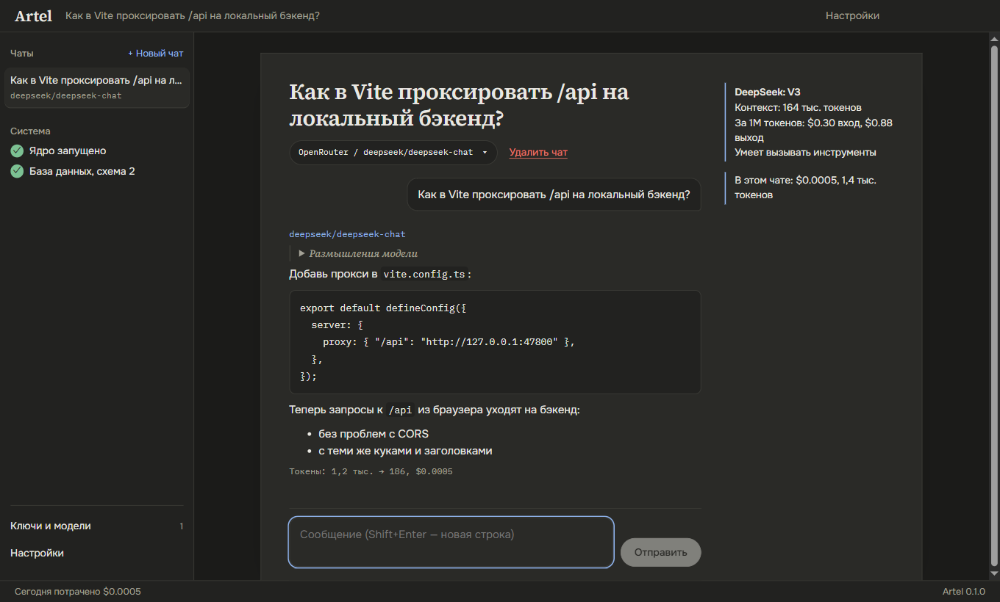

# Artel

Десктопное приложение для работы с любыми нейросетями по своим ключам. Цель проекта — артель
ИИ-агентов, которая пишет код в отдельной копии твоего проекта, сама доказывает, что всё работает,
и отдаёт правки тебе на вычитку.

*A desktop app for chatting with any AI model using your own API keys. It is growing into a team of
AI agents that write code in an isolated copy of your project and hand the changes over for review.*


## Что уже умеет

- **Любые нейросети по твоим ключам.** OpenRouter (сотни моделей по одному ключу), DeepSeek,
  NVIDIA NIM, локальные Ollama и LM Studio, а также любой сервис с API в формате OpenAI.
- **Чат с потоковым ответом.** Ответ появляется по мере того, как модель его пишет; кнопка «Стоп»
  сохраняет написанное. У моделей с рассуждениями видно, как они думали. Ответы — в Markdown.
- **Деньги под контролем.** Токены и стоимость под каждым ответом, итог по чату, расход за день,
  баланс OpenRouter и DeepSeek.
- **Выбор модели по делу.** Поиск по сотням моделей с ценой за 1M токенов, размером контекста
  и поддержкой инструментов.
- **Ключи в безопасности.** Ключи хранятся только на твоём компьютере, зашифрованные AES-256-GCM;
  мастер-ключ защищён средствами Windows. В интерфейс, логи и API ключи не возвращаются.
- **Русский и английский, светлая и тёмная темы.**

| Ключи и модели | Выбор модели | Тёмная тема |
|---|---|---|
|  |  |  |

## Что дальше

1. Агент, который правит код в отдельной git-копии проекта, а ты принимаешь или возвращаешь правки построчно.
2. Порядок работы «опрос → спека → тесты до кода → код → проверка»: «готово» засчитывается, только когда тесты и сборка прошли.
3. Главный агент, который делит большую задачу между несколькими агентами на моделях подешевле.
4. Картинки через fal.ai, MCP-серверы, браузерная проверка собранного приложения.
5. Агенты из Claude Code, Codex и Gemini CLI по твоей подписке; прямые ключи Anthropic, OpenAI, Gemini и xAI.
6. Серверный режим: тот же интерфейс на твоём Linux-сервере, доступ через Tailscale.

Подробный план и принятые решения — в [docs/CONTEXT.md](docs/CONTEXT.md), дизайн — в [docs/DESIGN.md](docs/DESIGN.md).

## Запуск

Сейчас приложение собирается из исходников. Нужны Windows 10/11 и [Node.js](https://nodejs.org) 22.13 или новее.

```bash
git clone https://github.com/amave423/artel.git
cd artel
npm install
npm start
```

Дальше открой «Ключи и модели», выбери провайдера и вставь свой ключ. Данные приложения лежат
в `%APPDATA%\Artel`.

## Разработка

```bash
npm run dev         # интерфейс с горячей перезагрузкой, окно перезапускается при правках ядра
npm run verify      # типы, юнит-тесты, сборка и сквозные тесты на настоящем окне
npm run live-check  # проверка на реальных провайдерах: ключи берутся из .env (см. .env.example)
```

Устройство проекта и правила для участников — в [AGENTS.md](AGENTS.md).

## Лицензия

[MIT](LICENSE)
