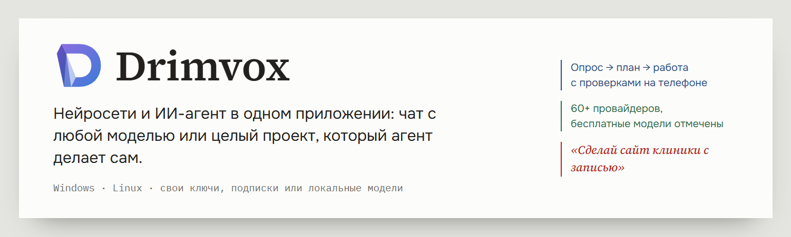
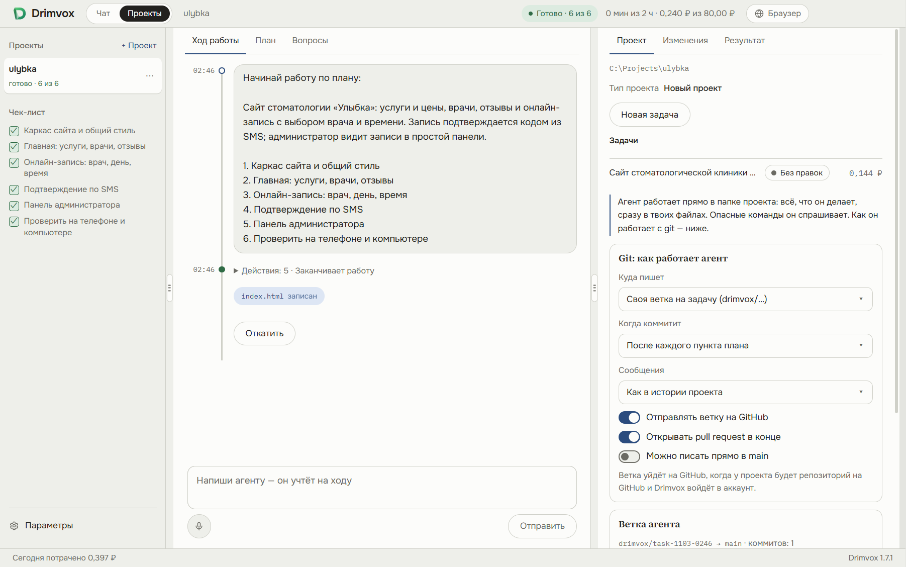
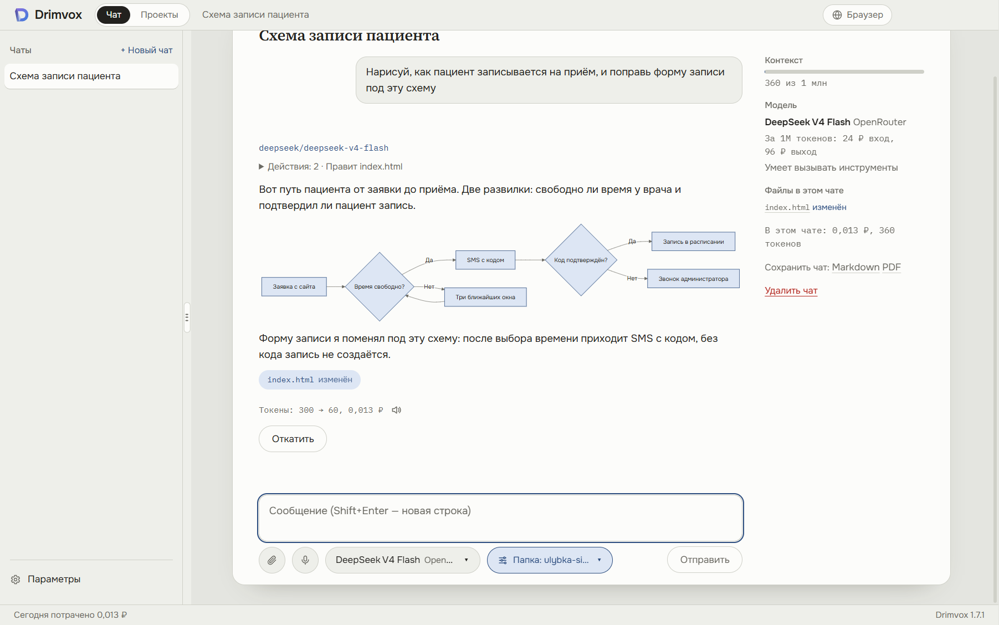
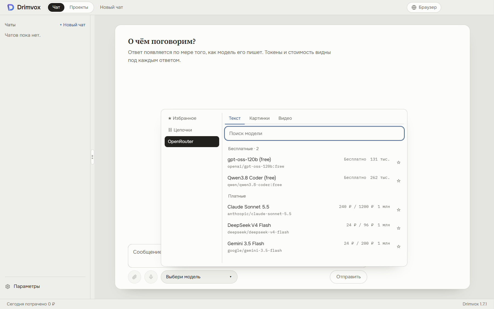
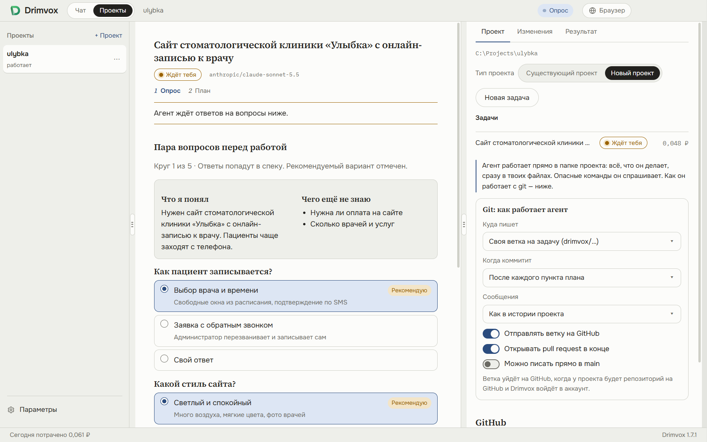
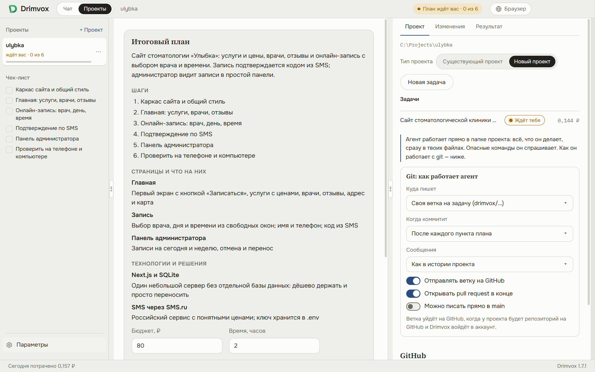
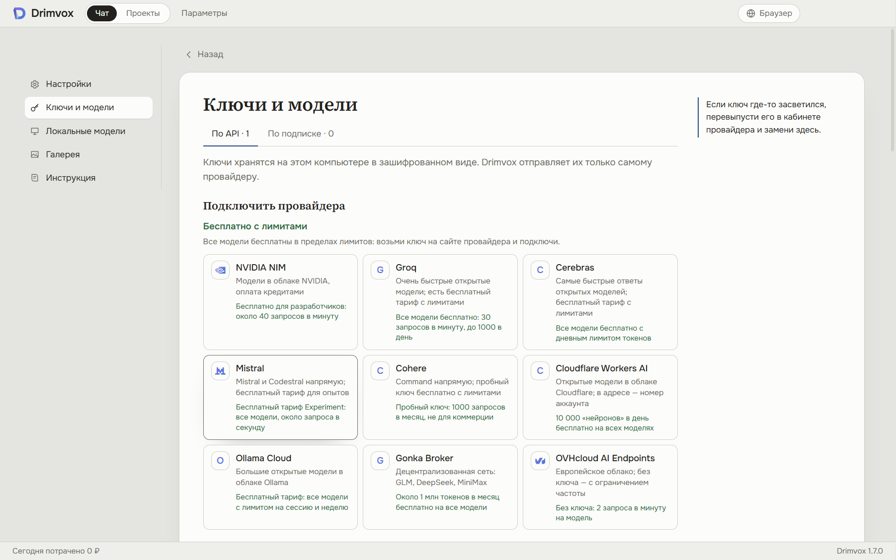
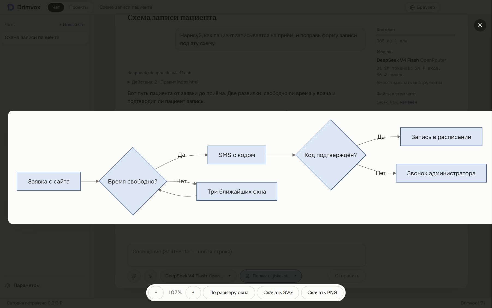
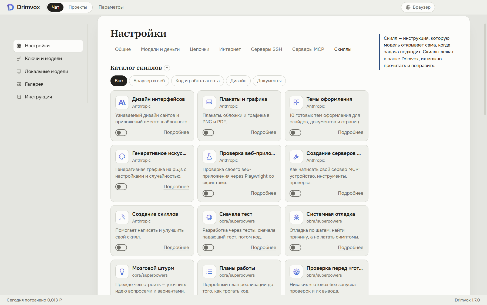
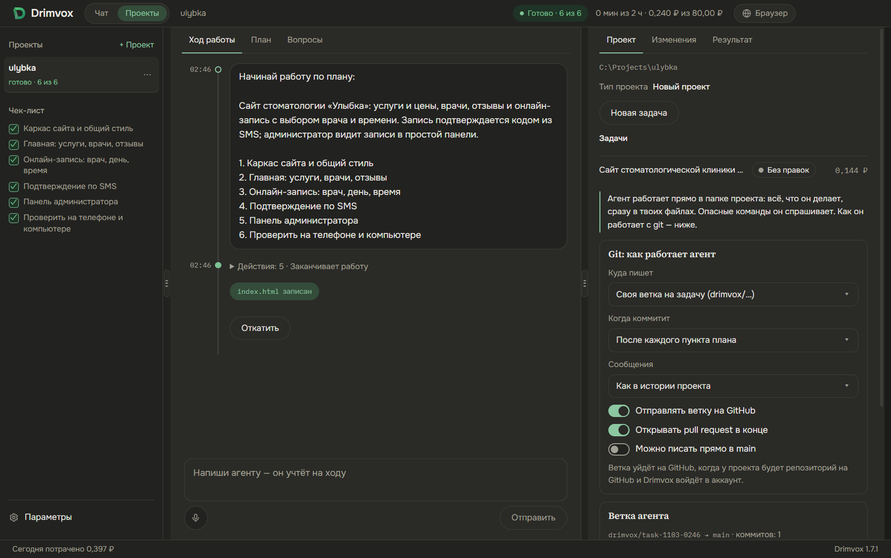

<p align="center">
  <picture>
    <source media="(prefers-color-scheme: dark)" srcset="docs/screenshots/banner-dark.png">
    
  </picture>
</p>

<p align="center">
  <a href="https://github.com/amave423/Drimvox/releases/latest"></a>
  <a href="https://github.com/amave423/Drimvox/releases"></a>
  
  <a href="LICENSE"></a>
</p>

<p align="center">
  <a href="#установка"><b>Скачать</b></a> ·
  <a href="#что-умеет">Что умеет</a> ·
  <a href="#инструменты-агента">Инструменты</a> ·
  <a href="#подключить-нейросеть">Нейросети</a> ·
  <a href="#если-что-то-не-работает">Помощь</a>
</p>

**Общайтесь с любой нейросетью в чате или поручите агенту целый проект.** Он расспросит, что нужно, напишет план и
сделает всё сам прямо в папке на вашем компьютере: напишет код, запустит его, посмотрит страницы на компьютере и
телефоне, исправит и покажет готовый результат. Вы платите напрямую сервисам нейросетей — по своему ключу, по
подписке Claude или ChatGPT — или работаете бесплатно: на бесплатных моделях провайдеров и на своём компьютере.

*Drimvox is a desktop app for Windows and Linux: chat with any AI model, or hand an agent a whole project — it
interviews you, writes a plan and builds it by itself right in your folder, checking its pages on a desktop and a
phone. Works with your own API keys, your Claude or ChatGPT subscription, free models or local ones.*

<p align="center">
  
</p>

## Что умеет

<table>
  <tr>
    <td width="50%" valign="top">
      <h3>Чат с любой моделью</h3>
      Сотни моделей десятков провайдеров в одном окне, цена каждого ответа в рублях. Диаграммы, формулы и код
      прямо в ответе; файлы, голосовой ввод, чтение ответов вслух. Подключите папку — и модель будет работать с
      файлами и командами, а любой её ответ можно откатить.
    </td>
    <td width="50%" valign="top">
      <h3>Агент делает проект</h3>
      Опрос с вариантами → итоговый план с бюджетом и временем → работа: код, тесты, проверка страниц на
      компьютере и телефоне во встроенном браузере, проверка безопасности и дизайна → готовый запущенный
      результат. Вы видите каждый шаг и можете написать агенту на ходу.
    </td>
  </tr>
  <tr>
    <td width="50%" valign="top">
      <h3>Бесплатно — честно отмечено</h3>
      Провайдеры разбиты на «бесплатно с лимитами», «есть бесплатные модели» и «только платные», на каждом
      написано, что именно бесплатно. Цепочки бесплатных моделей: занятая уступает следующей. Плюс модели на
      своём компьютере через Ollama.
    </td>
    <td width="50%" valign="top">
      <h3>Всё у вас</h3>
      Чаты, проекты и ключи хранятся на вашем компьютере, ключи зашифрованы. Опасные команды агент выполняет
      только после вашего «Разрешить». Git проекта — по вашим правилам: своя ветка, коммиты, pull request.
    </td>
  </tr>
</table>

<table>
  <tr>
    <td width="50%"><br><sub>Чат с папкой: схема прямо в ответе, изменённый файл под ним, справа контекст, модель и файлы чата</sub></td>
    <td width="50%"><br><sub>Выбор модели: бесплатные первыми, цены в рублях за миллион токенов</sub></td>
  </tr>
  <tr>
    <td width="50%"><br><sub>Проект начинается с опроса: что агент понял, чего не знает, варианты с рекомендацией</sub></td>
    <td width="50%"><br><sub>Итоговый план: шаги, страницы, технические решения, бюджет и время</sub></td>
  </tr>
  <tr>
    <td width="50%"><br><sub>«Ключи и модели»: провайдеры сгруппированы по тому, что у них бесплатно</sub></td>
    <td width="50%"><br><sub>Диаграмма на весь экран: приближение, перетаскивание, SVG и PNG</sub></td>
  </tr>
  <tr>
    <td width="50%"><br><sub>Каталог скиллов и серверов MCP: включаются одной кнопкой</sub></td>
    <td width="50%"><br><sub>Тёмная тема: цвета знака режима в выбранном и активном</sub></td>
  </tr>
</table>

## Инструменты агента

Что модель может делать сама — зависит от режима. В обычном чате она только говорит и ищет; подключите папку —
и она работает с файлами и программами; в проекте у агента полный набор и обязанность довести дело до конца.

| Набор | Обычный чат | Чат с папкой | Проект |
|---|:---:|:---:|:---:|
| **Интернет**: поиск, чтение страниц, встроенный браузер (нажимает, заполняет формы, смотрит на ширине телефона) | ✓ | ✓ | ✓ |
| **Картинки и видео** моделями провайдеров, взгляд на картинку моделью со зрением | ✓ | ✓ | ✓ |
| **Серверы MCP**: GitHub, базы данных, Figma, Sentry, Stripe и любые свои | ✓ | ✓ | ✓ |
| **Файлы**: найти, прочитать, записать, поправить; любой ответ откатывается | | ✓ | ✓ |
| **Команды и фоновые процессы**: установка, сборка, тесты, сервер разработки (опасное — с вашего разрешения) | | ✓ | ✓ |
| **Скиллы**: готовые инструкции, которые агент открывает сам (документы, безопасность, Next.js, Docker, десктоп на C# и Java…) | | ✓ | ✓ |
| **Проверка страниц**: снимки на компьютере и телефоне, «до и после», сверка с макетом из Figma, нагрузочный тест | | ✓ | ✓ |
| **Звук и видео**: расшифровка записи локальным whisper, обрезка, склейка, сжатие и кадры через ffmpeg | | ✓ | ✓ |
| **Графика и документы**: иконки и превью для ссылок из логотипа, диаграммы Mermaid в файл, текст с картинок и сканов | | ✓ | ✓ |
| **Окна программ** (Windows): запустить свою программу, прочитать её кнопки и поля, нажать, ввести, снять окно | | ✓ | ✓ |
| **Вокруг кода**: уязвимости зависимостей, серверы по SSH, временная почта для регистраций, скачанные файлы, проверка среды разработки | | ✓ | ✓ |
| **Работа до конца**: свой чек-лист, вопросы на ходу, проверка безопасности кода и дизайна перед «Готово», итоговый отчёт | | | ✓ |
| **Git по правилам**: своя ветка, коммиты после каждого пункта, отправка на GitHub и pull request; публикация сайта на GitHub Pages | | | ✓ |
| **Память проекта**: состояние и заметки в `AGENTS.md` — продолжить можно в новом разговоре или другой программе | | | ✓ |

## Установка

Скачайте установщик последней версии на странице **[Releases](https://github.com/amave423/Drimvox/releases/latest)**.

**Windows 10/11** — `Drimvox-Setup-<версия>.exe`. Ставится в профиль пользователя, права администратора не нужны.
Установщик спросит папку, ярлык на рабочем столе и ставить ли Ollama для локальных моделей.

<details>
<summary>Windows предупреждает об установщике</summary>

У установщика пока нет цифровой подписи (она платная), поэтому Windows его не знает:

- **«Система Windows защитила ваш компьютер»** (SmartScreen): «Подробнее» → «Выполнить в любом случае».
- **Защитник Windows пометил файл как угрозу** — ложное срабатывание на неподписанную программу: «Безопасность
  Windows» → «Защита от вирусов и угроз» → «Журнал защиты» → «Разрешить на устройстве». Исходный код открыт,
  установщик собирается на GitHub из этого репозитория ([сборки](https://github.com/amave423/Drimvox/actions)).

</details>

**Linux** — `Drimvox-<версия>-x86_64.AppImage` (любой дистрибутив: `chmod +x` и запустить) или
`Drimvox-<версия>-amd64.deb` для Ubuntu и Debian: `sudo apt install ./Drimvox-<версия>-amd64.deb`.

**Обновления** Drimvox скачивает сам и предлагает перезапуститься; «Настройки» → «Обновления» показывает, как идёт.
Ключи, чаты и проекты при обновлении сохраняются.

## Подключить нейросеть

«Параметры» (внизу слева) → «Ключи и модели». Провайдеры там разбиты на группы — можно начать бесплатно.

| | Провайдеры | Что бесплатно |
|---|---|---|
| **Бесплатно с лимитами** | Groq, Cerebras, Mistral, NVIDIA NIM, Cohere, Cloudflare Workers AI, Ollama Cloud, Gonka, OVHcloud | Все модели в пределах лимитов (запросы в минуту и в день, токены в месяц); у OVHcloud — даже без ключа |
| **Есть бесплатные модели** | Google Gemini, OpenRouter, LLM7, Kilo Code, OpenCode Zen, OrcaRouter, TeamoRouter, NaraRouter, Zhipu, Agnes AI, Vercel, Hugging Face, Pollinations | Gemini Flash и Gemma с дневным лимитом, модели с пометкой `free`, Turbo у LLM7 и 17 моделей Kilo — без ключа |
| **Только платные** | RouterAI (оплата в рублях), DeepSeek, Anthropic, OpenAI, xAI, Perplexity, Kimi, Qwen, MiniMax, Together, Fireworks и ещё три десятка | — |
| **Свой сервер** | LM Studio на этом компьютере, любой адрес, совместимый с OpenAI | — |

При подключении у провайдера есть ссылка «Где взять ключ». В выборе модели бесплатные стоят первыми, Drimvox проверяет,
что они правда отвечают, и прячет неработающие. Если провайдер не работает из вашей страны, Drimvox так и скажет —
тогда поможет [прокси](#настройки).

**По подписке** — без ключа и доплат, через программы самих компаний (раздел «По подписке»):

| Программа | Установка | Вход |
|---|---|---|
| Claude Code (подписка Claude) | `npm install -g @anthropic-ai/claude-code` | один раз запустить `claude` |
| Codex (подписка ChatGPT) | `npm install -g @openai/codex` | один раз запустить `codex` |
| Antigravity CLI (подписка Google) | Windows: `irm https://antigravity.google/cli/install.ps1 \| iex`<br>Linux: `curl -fsSL https://antigravity.google/cli/install.sh \| bash` | один раз запустить `agy` |

**Локально** — «Локальные модели» скачают модель, которая поместится в ваш компьютер, и покажут, быстро она будет
работать или медленно. Там же — картинки (stable-diffusion.cpp), распознавание речи (whisper.cpp) и голоса Piper.

## Чат

«+ Новый чат» слева или вопрос прямо на стартовой странице.

- **Скрепка** — картинки, PDF, документы, код, ZIP; перетащить или вставить Ctrl+V.
- **Микрофон** — надиктовать: идёт волна и таймер, язык диктовки задаётся в настройках. Распознаёт модель, которая
  слышит, или локальный whisper.
- **Динамик под ответом** — прочитать вслух голосом Windows, Piper или облачным: модели речи всех подключённых
  провайдеров (ElevenLabs, Gemini, OpenAI, Grok, MiniMax…).
- **«Параметры» у поля** — интернет (бесплатный поиск Drimvox или поиск провайдера), сколько модели думать и папка.
- **С папкой** под ответом видно, какие файлы модель записала, изменила или прочитала, — нажатие открывает файл;
  «Откатить» возвращает папку как было. Справа — заполненность контекста, модель с ценой и все файлы чата.
- Своё сообщение можно исправить — ответ напишется заново; чат сохраняется в Markdown или PDF.

## Проект

1. **«Проекты» → «+ Проект»** — новый (с опросом и планом) или существующий (сразу разговор с агентом в папке).
2. **«Что сделать?»** — словами или шаблоном (лендинг, магазин, Telegram-бот…); одна модель на всё или разные для
   опроса, плана и работы, и при желании сильная модель на случай, если рабочая застрянет.
3. **Опрос** — несколько кругов вопросов с вариантами; «Дальше решай сам» — и агент додумает остальное.
4. **План** — страницы, решения, шаги, бюджет и время; правки словами — план перепишется. «Начать работу».
5. **Работа** — агент сам пишет код, ставит зависимости, запускает тесты и сервер, проходит сценарии во встроенном
   браузере на компьютере и телефоне. Перед завершением — проверка безопасности кода и дизайна, найденное он
   исправляет. Пишите ему когда угодно — он учтёт со следующего шага; вопросы он задаёт, не останавливаясь.
6. **Готово** — итог, запущенный результат, отчёт и изменения по файлам. Git — по правилам из карточки «Git: как
   работает агент»; опубликовать репозиторий на GitHub и сайт на GitHub Pages можно в пару нажатий.

С подпиской (Claude Code, Codex) план выполняет сама эта программа в папке проекта.

## Скиллы и MCP

**Скилл** — готовая инструкция, которую агент открывает сам, когда задача подходит. Каталог в «Настройки» →
«Скиллы»: от Anthropic и сообщества, а также свои у Drimvox — документы Word, Excel, PowerPoint и PDF, проверка
безопасности по OWASP, SEO и скорость, доступность, Next.js, FastAPI, Docker, README, HTML-письма, приложения на C#,
Avalonia и Java, установщики. Свой скилл — папка с `SKILL.md` в общей папке скиллов или в
`.drimvox/skills/<имя>/` проекта (формат как у Claude Code).

**MCP** даёт агенту внешние инструменты. В каталоге — GitHub, Figma, PostgreSQL, SQLite, Sentry, Stripe, Context7,
Exa и другие; свой сервер — командой запуска или адресом. Для каждого сервера вы выбираете, о чём он спрашивает:
всегда, только об изменениях или без вопросов.

## Браузер

Кнопка «Браузер» справа сверху — настоящая вкладка Chromium в окне Drimvox (на сервере — тот же браузер живой
картинкой). Агент пользуется им сам: открывает страницы, нажимает, заполняет формы, смотрит на ширине телефона.
У браузера свой профиль — к вашему Chrome и паролям доступа нет. Если сайт просит пройти проверку или войти, панель
откроется сама: сделайте это и нажмите «Готово». Встроены инструменты разработчика: консоль, сеть, скорость
страницы, аудит.

## Настройки

Тема и язык, валюта (рубли или доллары по курсу ЦБ), бюджет на месяц и бюджет проекта, уведомления со своими
звуками, модели для голоса и проверки по скриншотам, цепочки бесплатных моделей, поисковик, серверы SSH, прокси для
провайдеров (`http://логин:пароль@адрес:порт` и «Через прокси» у нужных), файлы-указатели для других агентов
(`CLAUDE.md`, `GEMINI.md`, `QWEN.md`).

## Если что-то не работает

| Что | Что делать |
|---|---|
| Windows не даёт установить | [Установка](#установка): «Подробнее» → «Выполнить в любом случае» или «Разрешить на устройстве» в Защитнике |
| «Провайдер не работает из вашей страны» | VPN для всего компьютера или прокси в настройках и «Через прокси» у провайдера |
| Диктовка: «На счёте провайдера закончились деньги» | OpenRouter принимает звук только при балансе от $0.50, даже на бесплатных моделях. Выберите локальный whisper или другую модель |
| Модель с Hugging Face не скачивается | Прокси в настройках и «Повторить» — скачивание продолжится с того же места |
| Программа по подписке «не вошла в аккаунт» | Запустите её один раз в терминале (`claude`, `codex`, `agy`) и войдите |
| «Git не знает вашего имени и почты» | `git config --global user.name "Имя"` и `git config --global user.email "почта"` |
| Не приходит обновление | «Настройки» → «Обновления» покажет ошибку; подробности — в `logs/updates.log` в папке данных (`%APPDATA%\Drimvox`) |

## Свой сервер

Drimvox можно поставить на Linux-сервер и открывать в браузере с любого своего устройства: наружу через
[Tailscale](https://tailscale.com) с HTTPS, вход по паролю. Нужны Node.js 24, git и Tailscale с включённым HTTPS.

```bash
git clone https://github.com/amave423/Drimvox.git
cd Drimvox
npm run server:install
```

Скрипт поставит службу `drimvox` и напечатает адрес вида `https://<машина>.<сеть>.ts.net` и код первого входа.
Обновление — `git pull` и снова `npm run server:install`; журнал — `sudo journalctl -u drimvox -f`.

## Разработка

Нужны [Node.js](https://nodejs.org) 22.13 или новее и git.

```bash
git clone https://github.com/amave423/Drimvox.git
cd Drimvox
npm install
npm run dev           # интерфейс с горячей перезагрузкой
npm run verify        # типы, юнит-тесты, сборка и тесты на настоящем окне — единственное «готово»
npm run screenshots   # заново снять картинки для этого README
npm run dist          # установщик для этой системы в apps/desktop/release
```

Устройство проекта и правила — в [AGENTS.md](AGENTS.md), замысел — в [docs/CONTEXT.md](docs/CONTEXT.md), дизайн —
в [docs/DESIGN.md](docs/DESIGN.md), как устроена каждая часть — в [docs/specs](docs/specs).

## Лицензия

[MIT](LICENSE)
