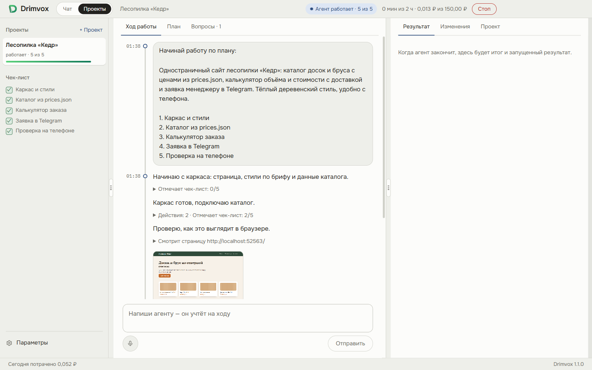
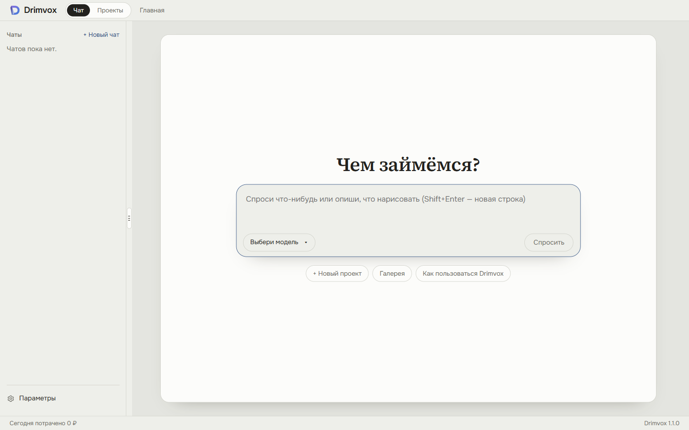
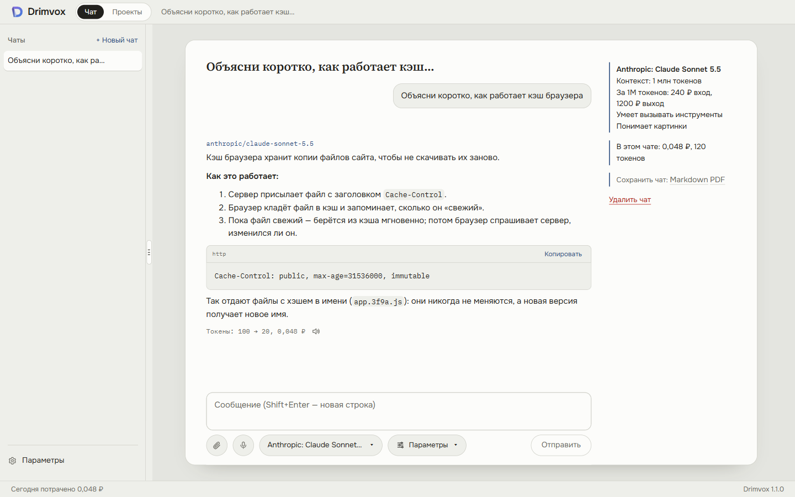
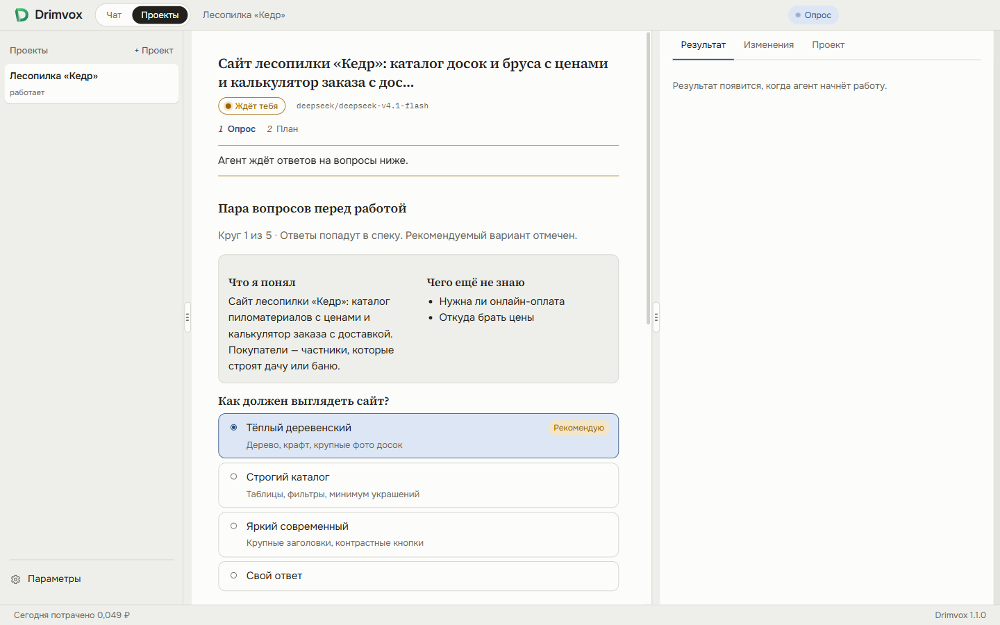
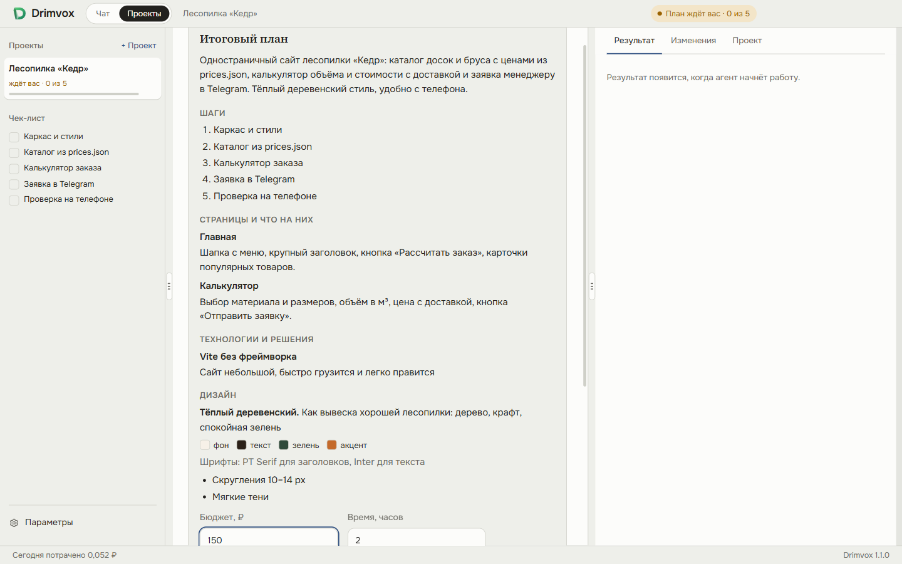
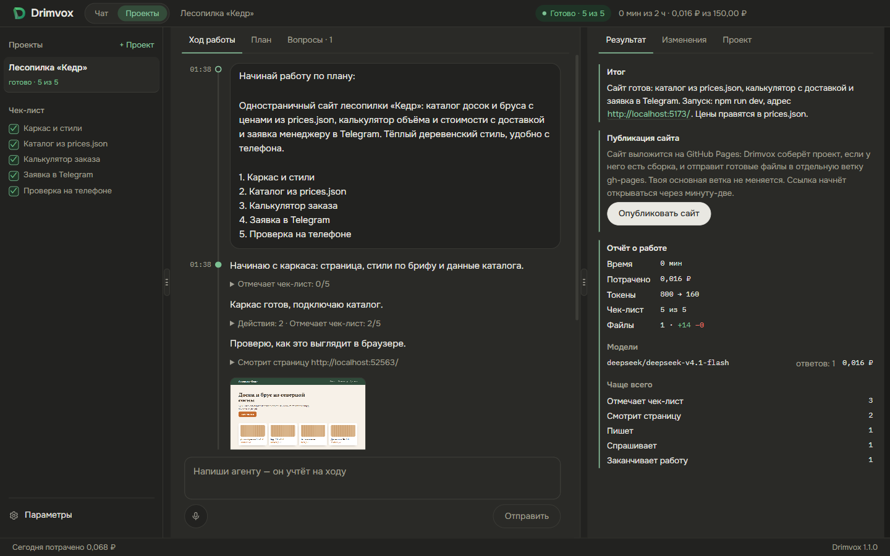
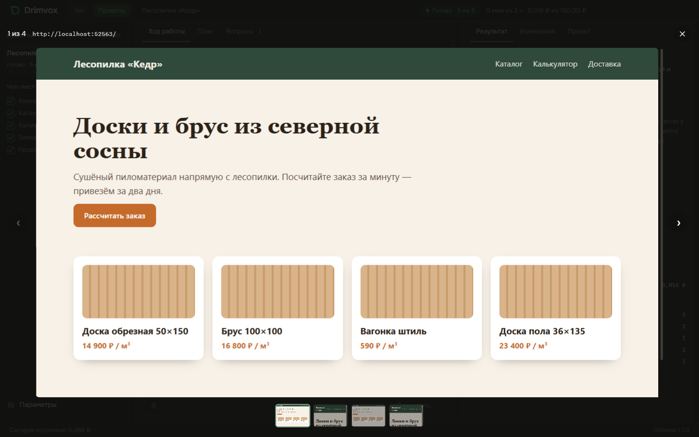
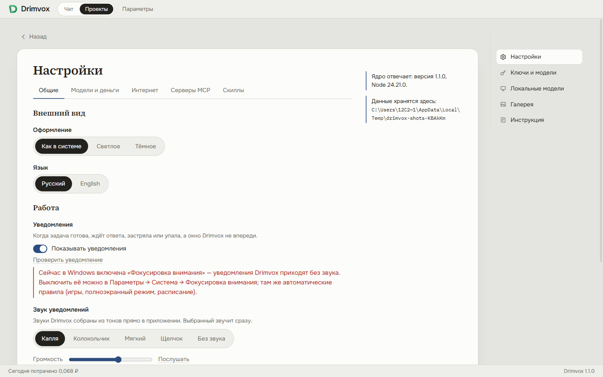

# Drimvox

**Нейросети и ИИ-агент в одном приложении для Windows и Linux.** Общайтесь с любой нейросетью в чате или
поручите агенту целый проект: он расспросит, что нужно, напишет план и сделает всё сам прямо в папке на вашем
компьютере — напишет код, запустит его, посмотрит на страницы на компьютере и телефоне, исправит и покажет
готовый результат.

*Drimvox is a desktop app for Windows and Linux: chat with any AI model, or hand an agent a whole project — it
interviews you, writes a plan and builds it by itself right in your folder, checking its pages on a desktop and a phone.
Works with your own API keys, your Claude or ChatGPT subscription, or local models.*



## Что это и кому пригодится

- **Тем, кто не программирует, но хочет свой сайт, бота или небольшую программу.** Не нужно знать, как это
  делается: агент задаёт вопросы простыми словами, предлагает варианты, пишет понятный план с бюджетом и временем —
  и работает, пока не сделает. Вы видите каждый шаг и можете вмешаться в любой момент.
- **Разработчикам** — как второй исполнитель: отдать агенту задачу в своём репозитории, следить за чек-листом и
  изменениями файлов, коммитить самому. Git остаётся вашим.
- **Всем, кто пользуется нейросетями каждый день.** Один чат вместо десятка сайтов: сотни моделей разных компаний,
  цена каждого ответа в рублях, свои ключи, подписки или бесплатные модели на своём компьютере.

### Чем отличается

- **Вы платите напрямую сервисам нейросетей** — по ключу (RouterAI, OpenRouter, DeepSeek, Google и другие), по
  подписке Claude или ChatGPT или вообще бесплатно локальными моделями. Drimvox не берёт наценку.
- **Всё хранится у вас.** Чаты, проекты и ключи — на этом компьютере, ключи зашифрованы.
- **Агент работает сам и до конца**: опрос → план → работа с проверками на компьютере и телефоне → проверка
  дизайна → готовый запущенный результат. Бюджет и время задаёте вы, опасные команды — только с вашего разрешения.
- **По-русски и в рублях**: интерфейс на русском и английском, цены по курсу ЦБ, российские агрегаторы с оплатой
  в рублях.

## Как это выглядит

| | |
|---|---|
|  Стартовая страница: вопрос любой модели сразу |  Выбор из сотен моделей с ценами в рублях |
|  Чат: ответы с кодом, цена и токены под каждым |  Проект начинается с опроса: варианты и рекомендация |
|  Итоговый план: страницы, решения, дизайн, бюджет и время |  Работа готова: итог, отчёт, публикация сайта |
|  Как агент видел страницы — листаются стрелками |  Параметры — отдельная страница с разделами |

---

## Содержание

1. [Установка](#установка)
2. [Подключить нейросеть](#подключить-нейросеть)
3. [Два режима и параметры](#два-режима-и-параметры)
4. [Чат](#чат)
5. [Проект: агент делает всё сам](#проект-агент-делает-всё-сам)
6. [Локальные модели](#локальные-модели)
7. [Картинки и видео](#картинки-и-видео)
8. [Уведомления](#уведомления)
9. [Скиллы](#скиллы)
10. [MCP-серверы](#mcp-серверы)
11. [Настройки](#настройки)
12. [Если что-то не работает](#если-что-то-не-работает)
13. [Свой сервер](#свой-сервер)
14. [Разработка](#разработка)
## Установка

Скачай установщик последней версии на странице [Releases](https://github.com/amave423/Drimvox/releases).

**Windows 10/11** — `Drimvox-Setup-<версия>.exe`. Ставится в профиль пользователя, права администратора не нужны.
Установщик спросит папку, нужен ли ярлык на рабочем столе и ставить ли Ollama: с этой галочкой Drimvox при первом
запуске сам скачает Ollama и покажет прогресс в «Локальных моделях».

У установщика пока нет цифровой подписи (она платная), поэтому Windows его не знает и предупреждает:

- **«Система Windows защитила ваш компьютер»** (SmartScreen): нажми «Подробнее» → «Выполнить в любом случае».
- **Защитник Windows пометил файл как угрозу** — это ложное срабатывание на неподписанную программу. Открой
  «Безопасность Windows» → «Защита от вирусов и угроз» → «Журнал защиты», найди файл и выбери «Разрешить
  на устройстве». Исходный код открыт: установщик собирается на GitHub из этого репозитория
  ([сборки](https://github.com/amave423/Drimvox/actions)).

**Linux** — `Drimvox-<версия>-x86_64.AppImage` (любой дистрибутив: `chmod +x` и запустить) или
`Drimvox-<версия>-amd64.deb` для Ubuntu и Debian: `sudo apt install ./Drimvox-<версия>-amd64.deb`.

**Обновления.** Drimvox сам проверяет новые версии, скачивает их в фоне и предлагает перезапуститься
(версия из .deb только сообщает и даёт ссылку). Как идёт обновление, видно в «Настройки» → «Обновления»;
там же кнопка «Проверить сейчас». Ключи, чаты и проекты при обновлении сохраняются.

## Подключить нейросеть

Drimvox не продаёт доступ к нейросетям: он работает с теми, что подключишь ты. Открой «Параметры» (внизу слева)
→ «Ключи и модели».
Подойдёт любой из трёх путей.

### По ключу

Зарегистрируйся у провайдера, пополни баланс, создай ключ и вставь его в Drimvox. Ключ хранится на твоём компьютере
в зашифрованном виде и уходит только самому провайдеру. У каждой модели в списке видна цена за 1 млн токенов.

| Провайдер | Чем удобен | Где взять ключ |
|---|---|---|
| RouterAI | Сотни моделей, оплата в рублях, картинки и видео | [routerai.ru](https://routerai.ru/) |
| OpenRouter | Сотни моделей разных компаний, есть бесплатные | [openrouter.ai/settings/keys](https://openrouter.ai/settings/keys) |
| DeepSeek | Сильные и дешёвые модели для кода | [platform.deepseek.com](https://platform.deepseek.com/api_keys) |
| Google Gemini | Бесплатный дневной лимит на Flash, Flash-Lite и Gemma | [aistudio.google.com/apikey](https://aistudio.google.com/apikey) |
| NVIDIA NIM | Бесплатные кредиты на открытые модели | [build.nvidia.com](https://build.nvidia.com/settings/api-keys) |
| Anthropic, OpenAI, xAI | Claude, GPT, Grok напрямую | [Anthropic](https://console.anthropic.com/settings/keys), [OpenAI](https://platform.openai.com/api-keys), [xAI](https://console.x.ai/) |
| OpenAI-совместимый | Любой сервис с API в формате OpenAI | адрес и ключ — у сервиса |

Бесплатные модели в списке идут первыми; Drimvox проверяет, что они действительно отвечают, и прячет неработающие.
Если провайдер не работает из твоей страны, Drimvox так и скажет — тогда нужен [прокси](#прокси).

### По подписке

Если ты платишь за Claude или ChatGPT, Drimvox может работать через их программы — без ключа и без доплат.
Раздел «По подписке» на той же странице:

| Программа | Установка | Вход |
|---|---|---|
| Claude Code (подписка Claude) | `npm install -g @anthropic-ai/claude-code` | один раз запусти `claude` в терминале |
| Codex (подписка ChatGPT) | `npm install -g @openai/codex` | один раз запусти `codex` |
| Antigravity CLI (подписка Google) | Windows: `irm https://antigravity.google/cli/install.ps1 \| iex`, Linux и macOS: `curl -fsSL https://antigravity.google/cli/install.sh \| bash` | один раз запусти `agy` |

Для `npm` нужен [Node.js](https://nodejs.org). Gemini CLI для личных аккаунтов Google больше не работает
(Google отключил его 18 июня 2026), вместо него — Antigravity CLI. Остаток лимита подписки Drimvox показывает
у провайдера и рядом с чатом, когда программа его сообщает (Claude Code, Codex).

### Локально

«Локальные модели» скачают модель, которая поместится в твой компьютер, — бесплатно и без интернета после
скачивания. Подробнее — [ниже](#локальные-модели).

## Два режима и параметры

Сверху рядом с логотипом — переключатель **«Чат | Проекты»**. У каждого режима свой список слева и свой цвет
логотипа: фиолетово-голубой у чата, зелёный у проектов. **«Параметры»** внизу слева открывают отдельную страницу
с разделами справа: настройки, ключи и модели, локальные модели, галерея и инструкция; «‹ Назад» возвращает
туда, где ты был. Боковую панель и панель результата можно сузить, расширить или скрыть — ручкой с тремя
чёрточками. Подробная инструкция для новичков есть в самом приложении: «Параметры» → «Инструкция».

## Чат

«+ Новый чат» в списке слева или вопрос прямо на стартовой странице. У поля ввода:

- **Скрепка** — приложить файлы: картинки, PDF, документы, код, ZIP. Можно перетащить или вставить Ctrl+V.
  Большие фото Drimvox сам уменьшает. Картинку можно открыть на весь экран — и до отправки, и в сообщении.
- **Микрофон** — надиктовать вопрос; кнопка с динамиком под ответом читает его вслух (голоса Piper).
- **Выбор модели** — поиск по всем подключённым провайдерам, с ценой и размером контекста; звёздочка — в избранное.
- **«Параметры»** — что разрешено модели в этом чате:
  - *Интернет*: без интернета, бесплатный поиск Drimvox или платный поиск провайдера;
  - *Мышление*: сколько модель думает перед ответом (дольше — точнее, но медленнее и дороже);
  - *Папка*: подключить папку на компьютере — модель сможет читать, править файлы и запускать команды прямо в ней.
    Опасные команды она выполнит только после твоего «Разрешить» и объяснит, что команда делает. Под ответом,
    который что-то изменил, есть «Откатить».

Ответ печатается по мере того, как модель пишет; «Стоп» сохраняет написанное. Под ответом — токены и цена.
Своё сообщение можно исправить — ответ напишется заново. Чаты слева можно переименовать (карандаш), удалить или
выбрать несколько и удалить сразу. Чат сохраняется в Markdown или PDF.

## Проект: агент делает всё сам

1. **«Проекты» → «+ Проект»** — выбери папку: с кодом или пустую. Если в ней нет git, Drimvox спросит, включить ли
   историю версий (git живёт только в папке, на GitHub ничего не уходит).
2. **«Что сделать?»** — опиши задачу словами или нажми шаблон (лендинг, магазин, Telegram-бот…). Выбери модель — одну
   на опрос, план и работу или «Разные модели для этапов» — и, если хочешь, сильную модель: она подключится, если
   основная застрянет. Нажми «Начать опрос».
3. **Опрос.** Агент задаст несколько кругов вопросов с вариантами (рекомендуемый отмечен) и предложит направления
   дизайна; «Дальше решай сам» — и он додумает остальное.
4. **Итоговый план**: что строим, страницы, технологии, дизайн и шаги. Напиши правки — план перепишется. Укажи
   бюджет и время и нажми «Начать работу».
5. **Агент работает сам**, прямо в папке: читает и правит файлы, ставит зависимости, пишет и запускает тесты,
   поднимает сервер разработки, смотрит страницы на компьютере и телефоне и проходит сценарии как человек.
   Перед завершением Drimvox сам фотографирует результат и строго оценивает дизайн по плану; если нужно — агент
   получает конкретные замечания на один круг правок.
6. **Мастерская проекта**: в середине — лента хода работы (сообщения и действия по времени, скриншоты листаются
   стрелками) и вкладки «План» и «Вопросы»; слева — проекты и чек-лист; сверху — состояние, время и деньги
   (нажатие — изменить бюджет и часы на ходу) и «Стоп». Пиши агенту когда хочешь — он учтёт со следующего шага.
7. **Готово**: справа во вкладке «Результат» — итог, «Открыть» (Drimvox сам запустил результат) и отчёт о работе;
   «Изменения» — что поменялось в папке, нажми на файл, чтобы увидеть код. Коммит делаешь ты.

Если работает модель по подписке (Claude Code, Codex), план выполняет сама эта программа в папке проекта.

**Опубликовать на GitHub.** Вкладка «Проект» → раздел GitHub: «Подключить GitHub» покажет код, его нужно ввести на
github.com/login/device (пароль в Drimvox не вводится). Потом — название репозитория, приватный он или нет, и
подтверждение. Сайт можно выложить на GitHub Pages кнопкой «Опубликовать сайт» во вкладке «Результат».
## Локальные модели

Модели на твоём компьютере через [Ollama](https://ollama.com/download).

- Нет Ollama — на Windows кнопка «Установить Ollama» (или галочка в установщике Drimvox) скачает официальный
  установщик; на Linux лист покажет команду.
- Drimvox смотрит память и видеокарту и показывает только то, что здесь запустится: «быстро» (влезает в видеокарту)
  или «медленно».
- Подборка проверенных моделей и поиск GGUF-моделей на Hugging Face с советом, какой вариант взять.
- У каждой модели — скачивание с прогрессом, оставшимся временем, паузой и отменой, а у скачанной — «Удалить».
- Если файлы Hugging Face из твоей сети не скачиваются (их файловый сервер бывает закрыт), задай [прокси](#прокси):
  Drimvox скачает через него и сверит контрольную сумму.

Картинки рисуются локально через stable-diffusion.cpp, речь распознаётся whisper.cpp, голоса для чтения вслух —
Piper: всё это ставится там же, в «Локальных моделях», кнопкой у нужной вкладки.

## Картинки и видео

С ключом RouterAI или OpenRouter в выборе модели появляются вкладки «Картинки» и «Видео». В списке видна цена
одной картинки или ролика; параметры (формат, размер, длина, звук) — в «Параметрах». Дорогое запускается только
кнопкой с ценой. Ролик делается несколько минут — можно уйти, он появится сам. Всё сделанное — в «Галерее».

## Уведомления

Когда агенту нужен ответ, работа готова или застряла, а окно Drimvox не впереди, в правом нижнем углу появляется
карточка Drimvox со звуком; нажатие открывает задачу или проект. Звук («Капля», «Колокольчик», «Мягкий», «Щелчок»
или без звука) и громкость — в настройках, там же «Проверить уведомление». Звуки собираются из тонов прямо в
приложении: никаких чужих записей. При включённой «Фокусировке внимания» Windows уведомления приходят без звука.

## Скиллы

Скилл — готовая инструкция для агента: как оформлять отчёты, как писать тесты, фирменный стиль. Агент видит
список скиллов и сам открывает нужный.

- **Из каталога:** «Параметры» → «Настройки» → «Скиллы» — готовые скиллы включаются одной кнопкой (например,
  `frontend-design` от Anthropic для более аккуратного дизайна).
- **Создать:** там же → «Создать скилл»: название, когда он нужен, инструкция.
- **Из папки:** скилл — это папка с файлом `SKILL.md` (формат как в Claude Code). Положи её в общую папку скиллов
  («Открыть папку скиллов») или в проект: `.drimvox/skills/<имя>/SKILL.md` или `.claude/skills/<имя>/SKILL.md`.

```markdown
---
name: report
description: Когда нужно оформить отчёт для клиента
---
Пиши отчёт так: сначала вывод в двух предложениях, потом таблица цифр, потом что делать дальше.
Рядом лежит пример: example.md.
```

Файлы рядом с `SKILL.md` (шаблоны, примеры) агент тоже может прочитать.

## MCP-серверы

MCP — способ дать агенту и чату внешние инструменты: GitHub, базы данных, Figma, файлы и сотни других.
«Параметры» → «Настройки» → «Серверы MCP»: готовые из каталога (GitHub, Figma, браузер и другие) или
«Добавить сервер», два вида:

- **Команда запуска** — Drimvox запускает программу у тебя на компьютере. Например, доступ к папке:
  `npx -y @modelcontextprotocol/server-filesystem C:\Users\me\Documents`. Ключи сервера — в «Переменные
  окружения», по одной в строке: `ИМЯ=значение`.
- **Адрес** — сервер в интернете. Например, GitHub: адрес `https://api.githubcopilot.com/mcp/`, в заголовках
  `Authorization: Bearer <токен GitHub>`.

Переменные и заголовки хранятся зашифрованными. При включении сервера ты выбираешь, о чём он спрашивает:
«Всегда спрашивать», «Только об изменениях» (по умолчанию: читать и искать можно молча, а изменить, удалить или
отправить — только с твоего «да») или «Без вопросов». Режим меняется в настройках у каждого сервера. Когда вопрос
всё же задан: «Разрешать всегда» запоминает этот инструмент, «Доверять всему серверу» — все инструменты сервера сразу. Если окно
не впереди, придёт уведомление, что чат ждёт разрешения. Браузер Playwright работает в фоне, без окна; чтобы видеть
его, допиши `--headed` в команду сервера.

## Настройки

- **Оформление и язык** — светлая и тёмная темы, русский и английский.
- **Уведомления** — свои карточки со звуком, см. [выше](#уведомления).
- **Валюта** — цены и расходы в рублях или долларах (по курсу ЦБ).
- **Бюджет на месяц** — предел расходов всего приложения; **бюджет проекта по умолчанию** — с чего начинается
  бюджет нового проекта.
- **Проверка по скриншотам** — модель, которая смотрит на страницы, если рабочая модель сама картинок не видит.
- <a id="прокси"></a>**Прокси для провайдеров** — если без VPN нейросети или Hugging Face недоступны: укажи
  `http://логин:пароль@адрес:порт` и включи «Через прокси» у нужных провайдеров.
- **Скиллы**, **MCP-серверы**, **Обновления** — см. выше.

## Если что-то не работает

| Что | Что делать |
|---|---|
| Windows не даёт установить | См. [Установка](#установка): «Подробнее» → «Выполнить в любом случае» или «Разрешить на устройстве» в Защитнике |
| «Провайдер не работает из твоей страны» / «Сервис недоступен в твоей стране» | Включи VPN для всего компьютера или задай прокси и «Через прокси» у провайдера |
| Модель с Hugging Face не скачивается | Задай прокси в настройках и нажми «Повторить» — продолжится с того же места |
| Программа по подписке «не вошла в аккаунт» | Запусти её один раз в терминале (`claude`, `codex`, `agy`) и войди |
| «Git не знает твоего имени и почты» | `git config --global user.name "Имя"` и `git config --global user.email "почта"` |
| Не приходит обновление | «Настройки» → «Обновления»: там видна ошибка; подробности — в `logs/updates.log` в папке данных (`%APPDATA%\Drimvox`) |

## Свой сервер

Drimvox можно поставить на Linux-сервер и открывать в браузере с любого своего устройства. Наружу он выходит через
[Tailscale](https://tailscale.com) с HTTPS, вход — по паролю. Нужны Node.js 24, git и Tailscale с включённым HTTPS
(в админке Tailscale: DNS → HTTPS Certificates).

```bash
git clone https://github.com/amave423/Drimvox.git
cd drimvox
npm run server:install
```

Скрипт поставит службу `drimvox` и напечатает адрес вида `https://<машина>.<сеть>.ts.net` и код первого входа.
Обновление — `git pull` и снова `npm run server:install`. Журнал: `sudo journalctl -u drimvox -f`.

## Разработка

Нужны [Node.js](https://nodejs.org) 22.13 или новее и git.

```bash
git clone https://github.com/amave423/Drimvox.git
cd drimvox
npm install
npm run dev         # интерфейс с горячей перезагрузкой
npm run verify      # типы, юнит-тесты, сборка и сквозные тесты на настоящем окне
npm run dist        # установщик для этой системы в apps/desktop/release
```

Выпуск версии после зелёного `npm run verify`: `npm run release -- <версия>`, затем `git push` и
`git push origin v<версия>` — GitHub соберёт установщики и выложит релиз. Устройство проекта и правила — в
[AGENTS.md](AGENTS.md), замысел и решения — в [docs/CONTEXT.md](docs/CONTEXT.md), дизайн — в
[docs/DESIGN.md](docs/DESIGN.md).

## Лицензия

[MIT](LICENSE)
